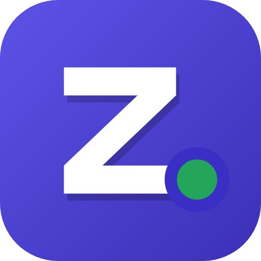

<p align="center"></p>

# Zrpc

A custom Discord Rich Presence app for Android, written in Kotlin with Jetpack Compose and Material 3, built around **protecting your Discord token**.

Not affiliated with Discord.

> **Warning**
> This app connects to the Discord gateway with your **user token**. Discord's Terms of Service treat that as self-botting. Presence-only use is rarely actioned, but use it at your own risk.

## Features

| Mode | What it does |
| --- | --- |
| **Custom RPC** | Name, details, state, activity type (Playing / Streaming / Listening / Watching / Competing), large & small images with hover text, up to two buttons, elapsed time or countdown, party size, member-list display, per-config Application ID. Save/load configs, import/export JSON, 30+ built-in presets, live preview. |
| **App Detection** | Shows the app you're currently using (pick which apps), with its icon and elapsed time. |
| **Media RPC** | Shows what's playing (title, artist, album, progress) from any player; optional album art. Video apps show as "Watching". |
| **Console RPC** | Pretend you're playing on PlayStation, Xbox, Switch, Steam Deck and more, with optional cover art and recent games. |
| **Experimental RPC** | Combines apps + media with your own templates (`{app}` `{title}` `{artist}` `{album}`). |

Also: Material You theming, status selector (Online / Idle / DND / Invisible), device type (mobile / desktop / web), image URLs and gallery images, runs in the background with screen off, auto-reconnect with session resume, in-app logs and crash reports.

## Token protections

| Threat | Protection |
| --- | --- |
| Token read from storage (root, backup, file copy) | Encrypted with **AES-256-GCM** under a non-exportable **Android Keystore** key (StrongBox when available). Plaintext never touches disk. Decryption failure wipes the vault (fail closed). |
| Backups / device transfer | `allowBackup=false` + `dataExtractionRules` excluding every domain. Neither the ciphertext nor the key leaves the device. |
| Token sent to the wrong server | Two separate HTTP clients. The authenticated one **refuses any non-Discord host** and **doesn't follow redirects**. The public one (image host, Play Store icons) strips `Authorization` and blocks any URL containing the token. Gateway URLs, including `resume_gateway_url` from the server, must be `wss://*.discord.gg`. |
| MITM / proxy certificate | Network security config: HTTPS only and **user-installed CAs are not trusted**. |
| Token in logs, crash reports, shared logs | Every log line passes a redactor (exact live token + token-shaped patterns + `Authorization` / `"token"` fields). IDENTIFY/RESUME frames are never logged. Release builds strip `Log.v/d/i` with R8. |
| Leftover login session | Discord login runs in a locked-down WebView (Discord pages only, no JS bridge, no file access). Right after sign-in, cookies, localStorage, IndexedDB, cache and form data are wiped. |
| Shoulder surfing / screenshots / screen recorders | `FLAG_SECURE` on login and profile (and optionally everywhere). Token is masked; **reveal and copy require biometrics / device PIN**; revealed token auto-hides after 20 s. |
| Clipboard snooping | Copied token is marked sensitive (hidden from clipboard previews on Android 13+) and auto-cleared after 30 s. |
| Someone picks up your unlocked phone | Optional **app lock** (biometric / device credential), re-locks after 30 s in background; toggling it requires authentication. |
| Stale or reset token | If Discord rejects the token (close code 4004) it is wiped immediately and you're asked to log in again; no reconnect loop. |
| Malicious shared config files | Imports containing anything token-shaped are rejected. Configs never contain secrets. |
| Token accidentally committed to this repo | CI runs `scripts/check-no-tokens.sh` on every push and PR. |
| Logout | Stops presence, deletes ciphertext, **destroys the Keystore key**, wipes the WebView session and caches. |

These are covered by unit tests (`app/src/test`): vault encryption, tamper handling and wipe; redaction; host allowlist and look-alike domains; interceptor blocking (verified that **no request reaches** a non-Discord server); gateway IDENTIFY/READY/presence flow and that the token never appears in logs or presence frames; 4004 handling.

See [SECURITY.md](SECURITY.md) for the full model and limits.

## Getting started

1. Install the APK (from [Releases](../../releases) or the CI artifact).
2. Log in with Discord (in-app) or paste a token.
3. *(For images)* Create an application at <https://discord.com/developers/applications> and paste its **Application ID** in Settings. The application's name doesn't matter; your presence uses the name you type.
4. For App Detection grant **Usage access**; for Media RPC grant **Notification access** (only media sessions are read).
5. If presence stops with the screen off, set battery usage to *Unrestricted* (Settings › Background).

### Images

- **URL** (`https://...`): proxied through Discord's external-assets API on discord.com.
- **Asset name**: an image uploaded to your Discord application's Rich Presence art assets.
- **Gallery image / app icons / album art**: uploaded to catbox.moe so Discord can fetch them. Requires *Allow image uploads*. Uploads are **public** and never include your token. App icons default to Play Store icons, which need no upload.

## Building

Requirements: JDK 17, Android SDK 35.

```bash
./gradlew :app:testDebugUnitTest   # 33 unit tests
./gradlew :app:assembleDebug       # app/build/outputs/apk/debug/
```

### Releasing

Push a tag like `v1.0.0`. The workflow builds a minified, signed APK and attaches it with SHA-256 checksums. Add these repository secrets first:

| Secret | Value |
| --- | --- |
| `KEYSTORE_BASE64` | `base64 -w0 release.jks` |
| `KEYSTORE_PASSWORD` | keystore password |
| `KEY_ALIAS` | key alias |
| `KEY_PASSWORD` | key password |

Create a keystore once with `keytool -genkeypair -v -keystore release.jks -keyalg RSA -keysize 4096 -validity 10000 -alias zrpc`. Never commit it (`*.jks` is git-ignored).

## Project layout

```
app/src/main/java/io/github/zrpc/
├── security/   TokenVault, TokenCipher (Keystore), TokenRedactor, TokenGuard (host allowlist),
│               AppLock (biometric), SecureScreen (FLAG_SECURE), WebSessionWiper, SensitiveClipboard
├── discord/    DiscordApi (REST), gateway/DiscordGateway (WebSocket), AssetResolver, ImageServices
├── rpc/        RpcService (foreground), RpcController, PresenceComposer, source/ (AppDetector, MediaWatcher)
├── data/       Settings (DataStore), RpcConfig + ActivityBuilder, ConfigRepository, presets
├── log/        AppLog (redacted), CrashHandler
└── ui/         Compose screens: login, home, custom, apps, media, console, experimental,
                profile, logs, settings, about
```

## License

GPL-3.0, see [LICENSE](LICENSE).
